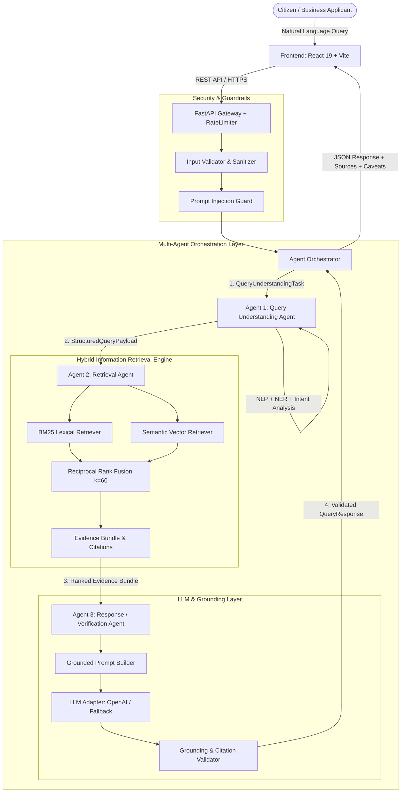
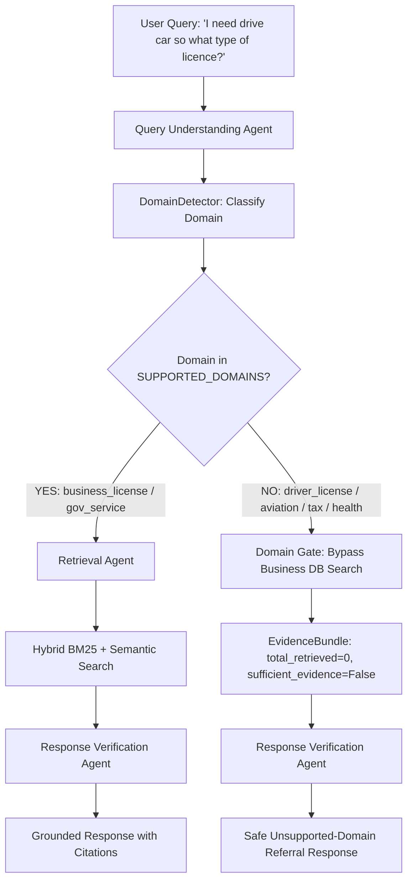

# GovGuide AI — System Architecture & Technical Specification

> **Module**: IT3041 – Information Retrieval and Web Analytics (SLIIT)  
> **Project**: GovGuide AI – An Agentic AI-Based Government Service Discovery, Eligibility, and Information Retrieval Platform  
> **Architecture Version**: 2.0.0  

---

## 1. Executive Architectural Overview

GovGuide AI is an agentic AI platform designed to deliver verified, database-grounded discovery, eligibility analysis, and application guidance for municipal government services and business licensing (City of Chicago BACP domain).

The system replaces traditional keyword search and ungrounded conversational chatbots with a **three-tier multi-agent pipeline** integrated with a **hybrid Information Retrieval engine (BM25 + Semantic Embeddings + Reciprocal Rank Fusion)**, strict **Responsible AI validation**, and **multi-layered security guards**.



---

## 2. Layered Architecture Breakdown

The architecture is partitioned into six decoupled, single-responsibility layers:

```
┌────────────────────────────────────────────────────────────────────────┐
│                        1. PRESENTATION LAYER                           │
│  React 19 • Vite • Vanilla CSS • Portal Theme • Interactive Chat / UI  │
└───────────────────────────────────┬────────────────────────────────────┘
                                    │ HTTP / JSON API
┌───────────────────────────────────▼────────────────────────────────────┐
│                  2. API GATEWAY & CONTROLLERS LAYER                    │
│  FastAPI • RateLimitMiddleware • JWT Auth • CORS • Error Handlers      │
│  Controllers: /query, /agents, /services, /sessions, /auth, /health    │
└───────────────────────────────────┬────────────────────────────────────┘
                                    │
┌───────────────────────────────────▼────────────────────────────────────┐
│                 3. MULTI-AGENT ORCHESTRATION LAYER                     │
│  Orchestrator • AgentRegistry • FailureHandler • InteractionLogger     │
│  Agent Communication Protocol (AgentMessage Envelope v1.0)            │
├──────────────────────────┬──────────────────────────┬──────────────────┤
│   Agent 1: Query Agent   │  Agent 2: Retrieval Agent│ Agent 3: Response│
│   - Tokenization & Norm  │  - Hybrid Search Exec    │ - Grounded Prompt│
│   - Intent Classification│  - RRF Rank Fusion       │ - LLM Generation │
│   - Domain NER & Codes   │  - Confidence Scoring    │ - Anti-Hallucinat│
│   - Structured Search Req│  - Evidence Packaging    │ - Source Citation│
└──────────────────────────┴────────────┬─────────────┴──────────────────┘
                                        │
┌───────────────────────────────────────▼────────────────────────────────┐
│               4. INFORMATION RETRIEVAL ENGINE (IR LAYER)               │
│  - BM25 Retriever (k1=1.5, b=0.75) • Inverted Index                    │
│  - Semantic Vector Retriever (Deterministic Embedding + Cosine Sim)    │
│  - Reciprocal Rank Fusion (RRF k=60)                                   │
│  - 9-Section Canonical Document Chunks (504 chunks, 56 services)       │
└───────────────────────────────────────┬────────────────────────────────┘
                                        │
┌───────────────────────────────────────▼────────────────────────────────┐
│               5. DATA STORAGE & PERSISTENCE LAYER                      │
│  PostgreSQL 16 (asyncpg + SQLAlchemy)                                  │
│  Tables: government_services, government_offices, business_licenses,   │
│          document_chunks, query_sessions, conversation_messages,       │
│          agent_interaction_logs, security_audit_logs, users            │
└────────────────────────────────────────────────────────────────────────┘
```

---

## 3. The Three Interacting Intelligent Agents

| Attribute | Agent 1: Query Understanding Agent | Agent 2: Retrieval Agent | Agent 3: Response / Verification Agent |
| :--- | :--- | :--- | :--- |
| **Agent Identifier** | `AgentId.QUERY_AGENT` | `AgentId.RETRIEVAL_AGENT` | `AgentId.RESPONSE_AGENT` |
| **Primary Input** | Natural Language Query (`raw_query`) in English, Tamil, Sinhala, Thanglish, or Mixed | `StructuredQueryPayload` | `EvidenceBundle` + User Query |
| **Core Responsibilities** | Multilingual & Thanglish normalization, typo/spelling correction, abbreviation expansion, conservative intent detection, domain NER & codes, pre-normalization security scan | BM25 search, semantic vector search, Reciprocal Rank Fusion (RRF), retrieval confidence scoring | Strict prompt synthesis, LLM generation, grounding check, citation verification, hallucination suppression |
| **Primary Output** | `StructuredQueryPayload` (normalized query, detected language, intent, entities) | `RetrievalResultPayload` (`EvidenceBundle`) | `ResponseResultPayload` (`QueryResponse`) |
| **Failure Mode** | Returns `VALIDATION_FAILED` or `INJECTION_DETECTED` | Returns `RETRIEVAL_FAILED` with safe error payload | Synthesizes grounded fallback from evidence or safe refusal |

---

## 4. Agent Communication Protocol

Inter-agent communication conforms to a strict, typed JSON envelope contract:

### 4.1. Common AgentMessage Envelope

```json
{
  "schema_version": "1.0",
  "request_id": "c6ccfcf3-1dd2-40d3-b03c-34675bacd56d",
  "correlation_id": "8713fadd-c4d8-4715-98c1-5d76d2483ed4",
  "timestamp": "2026-09-29T17:26:51.519Z",
  "sender": "query_agent",
  "recipient": "retrieval_agent",
  "message_type": "task",
  "payload": {
    "task_type": "information_retrieval",
    "structured_query": {
      "original_query": "How do I apply for a retail food business license in Chicago?",
      "cleaned_query": "How do I apply for a retail food business license in Chicago?",
      "expanded_query": "How do I apply for a retail food business license in Chicago? retail food establishment food",
      "intent": "application_procedure",
      "entities": [
        {"text": "retail food business license", "label": "SERVICE", "confidence": 0.95},
        {"text": "Chicago", "label": "LOCATION", "confidence": 0.90}
      ],
      "keywords": ["apply", "retail", "food", "business", "license", "chicago"],
      "is_safe": true,
      "is_ambiguous": false,
      "search_parameters": {
        "intent": "application_procedure",
        "target_services": ["retail food business license"],
        "target_locations": ["Chicago"]
      }
    }
  }
}
```

### 4.2. Agent REST API Endpoints

The system exposes explicit HTTP endpoints representing each agent's interface:

1. `POST /api/v1/agents/query-understanding`: Direct invocation of Agent 1.
2. `POST /api/v1/agents/retrieval`: Direct invocation of Agent 2.
3. `POST /api/v1/agents/response-verification`: Direct invocation of Agent 3.
4. `POST /api/v1/agents/pipeline`: Full pipeline execution returning step-by-step communication traces.
5. `GET /api/v1/agents/status`: Introspection of registered agents, parameters, and retrieval configurations.

---

## 5. Information Retrieval Architecture

The IR layer implements a multi-stage hybrid ranking pipeline:

### 5.1. BM25 Lexical Retrieval
- **Algorithm**: Okapi BM25
- **Parameters**: $k_1 = 1.5$, $b = 0.75$
- **Index**: Inverted term frequency index built over 504 canonical document chunks.
- **Normalization**: Alphanumeric extraction, hyphen/slash preservation (for municipal codes like `42-5`), stopword removal.

### 5.2. Semantic Vector Retrieval
- **Embedding Model**: Local deterministic semantic embedding generator mapping document chunks and queries into dense vector space.
- **Similarity Metric**: Cosine similarity:
$$\text{Cosine Similarity}(\vec{q}, \vec{d}) = \frac{\vec{q} \cdot \vec{d}}{\|\vec{q}\|_2 \|\vec{d}\|_2}$$

### 5.3. Reciprocal Rank Fusion (RRF)
Combines lexical and semantic ranked lists without requiring score scale normalization:
$$\text{RRF Score}(d) = \sum_{m \in \{\text{BM25}, \text{Semantic}\}} \frac{1}{k + \text{rank}_m(d)}$$
where $k = 60$ (standard TREC / IR configuration).

---

## 6. Database & Ingestion Architecture

The persistence layer stores both transactional application data and canonical knowledge representations:

```
[City of Chicago BACP Datasets (53,091 records)] 
   + [56 Government Service Profiles]
                 │
                 ▼
     [CSV Ingestion Engine]
                 │
                 ▼
     [Document Builder] ──► 9-Section Canonical Documents
                 │
                 ▼
     [Document Chunker] ──► 504 Semantic Document Chunks (PostgreSQL JSONB)
                 │
                 ▼
     [PostgreSQL Database] ──► Indexed via BM25 + Semantic Vectors
```

### 9-Section Canonical Document Hierarchy:
1. `service_overview`
2. `eligibility_criteria`
3. `required_documents`
4. `application_procedure`
5. `fee_schedule`
6. `renewal_conditions`
7. `responsible_office`
8. `governing_regulations`
9. `online_services`

---

## 7. Domain Detection & Cross-Domain Retrieval Gating

To prevent cross-domain retrieval errors (such as matching driving license queries against City of Chicago business license datasets), GovGuide AI implements a domain detection and gating layer:



### 7.1. Domain Taxonomy
- **Supported Domains**: `Domain.BUSINESS_LICENSE`, `Domain.GOVERNMENT_SERVICE`
- **Gated Unsupported Domains**: `Domain.DRIVER_LICENSE`, `Domain.AVIATION`, `Domain.VEHICLE_REGISTRATION`, `Domain.TAX`, `Domain.HEALTH`, `Domain.EDUCATION`, `Domain.OTHER`

### 7.2. Domain Gating Invariant
When an out-of-domain query is detected:
1. **Zero Database Query**: The Retrieval Agent suppresses municipal business license search.
2. **Zero False Citations**: No unrelated records (such as Mobile Food License or Tavern License) are ever returned.
3. **Official Referral**: The Response Agent produces a domain-tailored advisory directing citizens to the appropriate authority (e.g., Illinois Secretary of State / DMV for driving licenses, FAA for aviation).
4. **Wrong-Domain Retrieval Rate**: Maintained at **0.0%** across regression and evaluation benchmarks.

